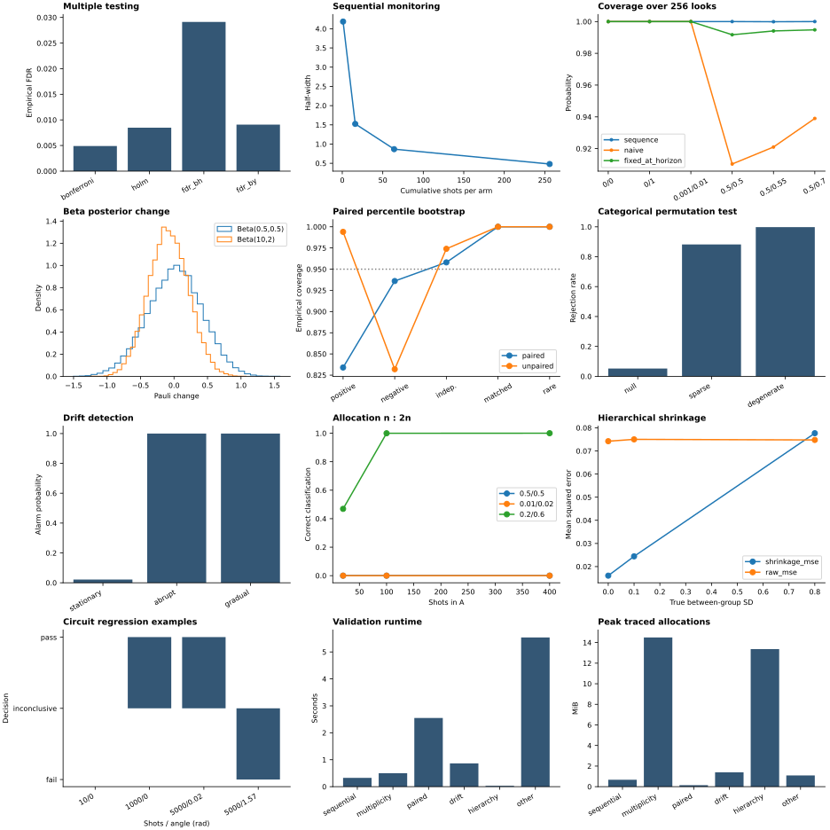

# Scientific validation protocol

Install the candidate with its stats extra, then run:

```sh
python benchmarks/validate.py
python -m pip install matplotlib
python benchmarks/figures.py
```

The fixed seed is 4703. Syntax and quick integration checks use
`python benchmarks/validate.py --smoke --out /tmp/bornlens-smoke`. The full
results, runtime, library versions and peak traced Python allocation sizes
are in metrics.csv and metadata.json. For rows aggregating replications, the
last column is the sample standard deviation divided by sqrt(R). Blank denotes
a deterministic calculation or a single summary. At zero observed failures a
zero plug-in MC SE does not imply a zero underlying probability: the one-sided
95% binomial upper bound is 1 - 0.05^(1/R).

## Sampling plans

- Each of six sequential scenarios uses 10,000 independent paths with looks
  at every integer from 1 through 256. Spending telescopes: the partial sum of
  alpha/[n(n+1)] equals alpha*(1-1/(N+1)). The event of any noncoverage has
  probability at most alpha under the fixed-pair independent-shot assumptions.
  First decision or horizon 256 is prespecified. Fixed-at-horizon and repeated
  fixed intervals are computed on the same paths.
- Multiplicity uses one-sided normal p-values, families of 4 and 12, dependence
  0, 0.65 or -0.06, and all-null or mixed configurations. FDR averages false
  rejections divided by max(1,rejections). Separate correlated-binomial
  simulations assess simultaneous coverage and directional classification errors
  under unequal shot counts. Comparing paired results across methods requires
  accounting for their common simulated data.
- Paired and categorical nested-resampling studies use 500 outer replications
  and 499 or 399 inner draws. This smaller outer sample is reported in every row.
  Other main simulation grids use 10,000 replications. Drift looks are disjoint
  with a shared independent reference. Change onset is window four.
- The random-effects grid varies group count, true heterogeneity, unequal
  standard errors and a shift of +2 in the first observation. The shift is
  contamination, not a change to the true target. Baseline zero is the pooled
  population mean. Bayesian reference values use adaptive quadrature.
- Timing includes tracing overhead. Traced allocations are not process RSS.
  Runtime and memory depend on host and library versions. Input generation,
  API checks and measurement are timed together per benchmark family.

## Results worth retaining

On equal-probability 0.5/0.5 paths, repeated fixed-sample intervals covered the
truth throughout the path in 91.03% of runs. The lowest sequence coverage was
99.99%, illustrating the cost of conservative spending. Paired bootstrap
coverage fell to 83.4% with 12 pairs in one correlated scenario. The plug-in
random-effects interval covered in 79.22% of runs with three groups and true
between-group SD 0.8, without contamination. These are properties of particular
designs, not universal method rankings.


